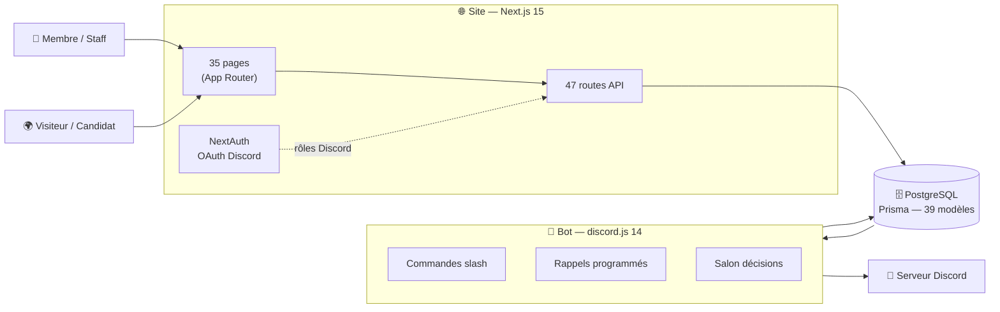
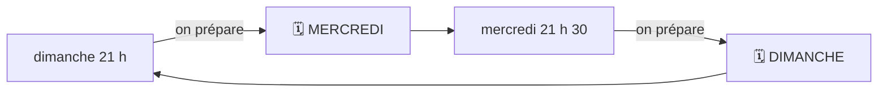
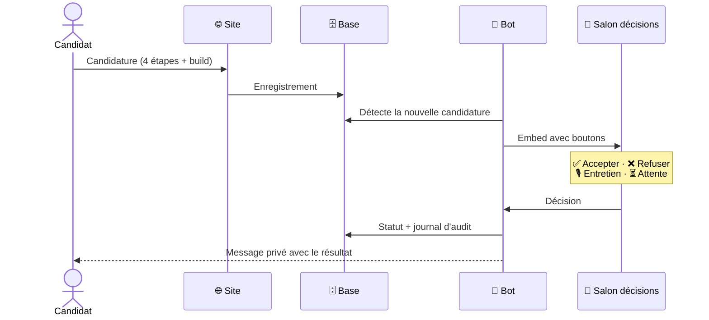
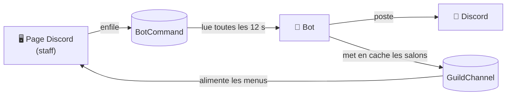
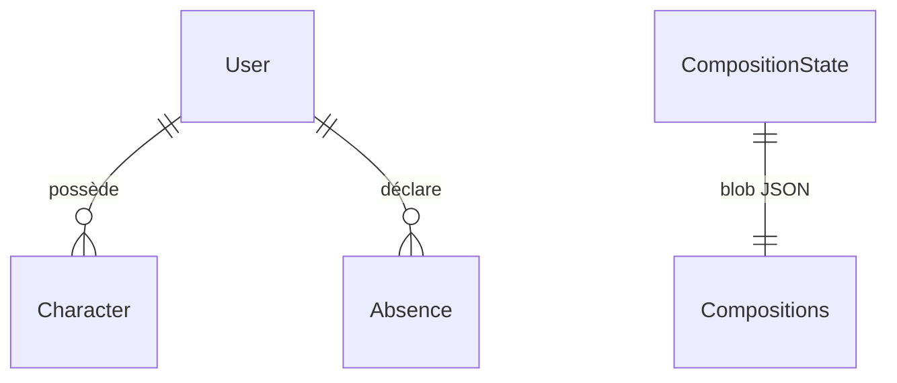

<div align="center">

# 🦉 Vanguard Control Center

**La plateforme tout-en-un de la guilde Vanguard** — serveur privé **Airborn : Winds of Rhisis**

Un site web et un bot Discord qui partagent la même base de données :
ce qui se passe sur le site se retrouve sur Discord, et inversement.

*Vanguard ne cherche pas le nombre mais la présence : **Discord et vocal obligatoires**.
Les outils de ce dépôt existent pour servir ça — préparer les Chambres Secrètes,
faire circuler les objets entre membres et suivre les progressions, sans paperasse.*


</div>

---

## 🧭 Vue d'ensemble



La base est le **point de rendez-vous** : le site écrit, le bot lit (et inversement).
Aucun des deux n'appelle l'autre en direct — c'est ce qui permet de redémarrer
l'un sans casser l'autre.

---

## 🗺️ Les quatre espaces

La navigation est rangée **par tâche**, pas par table. Chaque espace ouvre sur
ce qu'on vient y faire (`src/config/nav.ts`). La barre, le panneau « Tout » et le
plan du site (en bas de l'accueil, ex-`/sommaire`) se génèrent tous de ce fichier,
par `espacesPour(role)`.

| Espace | Accès | Pages |
|---|---|---|
| 👕 **AirBuilder** | public | Mes personnages · AirBuilder · Les mécaniques |
| 🧭 **Astuces** | public | Le wiki · Donjons · Guide · Prestige · Objets *(membres)* · Classes · Monstres · PNJ · Crafts |
| 🛡️ **Guilde** | public → membre | Information Guilde (`/guilde`) · Chambres Secrètes · World Boss · Mes absences — un visiteur n'y voit que « La guilde » (`/#la-guilde`, section de l'accueil) |
| 👑 **Bras droits** | staff | Tableau de bord tout-en-un (`/staff`) : la file « à traiter » · Membres & builds · Absences · Suivi · Candidatures (`?section=`) — Outils : Bot Discord · World Boss (gestion) · Events |

**Retirés le 2026-10-21** (décision de Maxime) : la Boutique et tout ce qui la servait
(commandes, conversations, dettes, ventes, requêtes d'objet sur mesure), le Coffre
AirGuild, le plan de farm, les statistiques et le journal — puis Quête Guilde tout
entière (page, routes, catalogue, fiche d'un pseudo, onglet du dossier). Les **données restent en
base** (aucun modèle ni colonne retiré) ; les anciennes adresses redirigent
(`next.config.js`) : pages staff → `/staff`, Boutique et ses adresses → `/`, et
`/annonce` → `/discord` (son onglet Embed envoyait la même commande).

**L'espace des bras droits** (les quatre rangs staff, `ADMIN_ROLES`) tient sur UNE page,
`/staff`, en sections (`?section=membres|absences|suivi|candidatures`, onglets lus dans la
rubrique « Tableau de bord » de `nav.ts`) : la file « à traiter » triée par urgence, quatre
compteurs et les outils ; Membres & builds (l'ancien GuildViewer) ; les absences ; le Suivi
(les mesures que l'AirBuilder exige par stuff, `GearProfile.mesures`, `src/lib/mesures.ts`) ;
les candidatures. `/guildviewer`, `/suivi` et `/candidatures` y redirigent avec leur requête.
Le calcul de la file vit dans `src/lib/recap.ts` (`GET /api/admin/a-traiter`), sans import
de Next : le bot pourra le reprendre pour son récap. Le dossier d'un membre s'ouvre de
n'importe quelle section par l'adresse (`?dossier=<id>&onglet=membre|absences|decisions|notes`).

**Le dossier d'un membre** porte les gestes et les notes internes (`src/lib/gestes.ts`, la
règle en un seul endroit) : promouvoir, rétrograder, cacher / montrer, retirer de la guilde
— ouverts aux quatre rangs bras droits, sur un rang strictement inférieur au sien, sans
promouvoir au-delà du rang juste sous le sien ; retirer un rôle, exclure, bannir — Vanguard
et plus. Motif obligatoire, confirmation, trace `ActionMembre`. Le rang se change SUR
DISCORD (file `BotCommand` « moderation », action `rang`, `bot/lib/moderation.ts`) : le bot
recalcule les rangs toutes les 10 minutes. Les notes (`NoteMembre`, ton problème / effort /
neutre) ne se lisent que sur un rang strictement inférieur au sien.

**L'accès des amis** (rôle Discord « Friend », `1550844483095232712` par défaut) : un compte
HORS de la guilde qui porte ce rôle voit les espaces Astuces et AirBuilder comme un membre —
`/objets`, la recherche d'objets, les recettes de `/crafts`, la provenance — et rien d'autre.
Son rang reste RECRUE : il ne figure dans aucune liste de la guilde, sauf la catégorie
repliée « Amis (hors guilde) » de Membres & builds (`/api/admin/users` renvoie `amis` à
part). Le réglage (rôles, espaces) est dans Bras droits → Outils → **Accès des amis**
(`/acces-amis`, `Setting` `acces_amis`, écriture Vanguard et plus). Une seule décision,
`peutOuvrir` (`src/config/nav.ts`), lue par le middleware (espaces du jeton, `token.amis`,
calculés dans le callback `jwt`), la barre et les gardes `requireEspace` / `apiEspace`
(`src/lib/access.ts`) ; la règle de l'ami est dans `src/config/amis.ts`. Le bot relit les
rôles Discord de chaque compte toutes les 10 minutes.

**L'accueil unique** (`/`) a trois visages, choisis côté serveur avec le rang en base
(`etatVisiteur()`) : **visiteur** (hero, le jeu, ce que le site fait, les huit classes,
la guilde, rejoindre), **membre** (bandeau, À faire, Mes outils, La guilde cherche, Mes
personnages, Les classes de la guilde, la guilde) et **bras droit** (le même, avec « À
traiter » en tête). La section « La guilde » (`#la-guilde`, ex-`/histoire`) est affichée
en entier pour tout le monde ; seul le plan du site est replié. Le HTML ne porte aucune
donnée de membre : les blocs du membre lisent `GET /api/accueil` (`src/lib/accueil.ts`,
garde `apiGuild`) et `GET /api/admin/a-traiter`. `/histoire` redirige vers `/#la-guilde`
(308) et `/dashboard` vers `/` (307).

Hors espaces : **Accueil**, **Postuler** (bouton à droite, masqué aux membres),
**Mon profil** (par le panneau du profil), **Connexion**.

---

## ⚔️ Les Chambres Secrètes

Une seule séance se prépare à la fois : **la prochaine**. Les fenêtres
s'enchaînent sans trou, et une annonce ne vaut que pour la fenêtre où elle a été
faite — tout se remet à zéro d'une séance à l'autre.



- **Composition** — 12 postes (dont 2 optionnels) répartis en tanks, DPS physique,
  DPS magique. Plusieurs candidats par poste ; le staff choisit le titulaire ★.
- **Présence** — une pop-up la demande à l'arrivée, une fois par séance. La
  composition est une **cible, pas un plafond** : on voit ce qui manque *et* qui
  est en plus, et le staff retient qui joue.
- **Stratégie** — un sous-onglet que le staff compose lui-même en blocs (titre,
  paragraphe, image importée ou liée).

---

## 🏛️ Information Guilde

La page des **membres**, tout-en-un (`/guilde`, la première ligne du menu Guilde, et
celle où un membre arrive après la connexion) : le récap (membres, classes
représentées, prochaine Chambre Secrète, absents du jour — les noms seulement —,
stuffs mesurés), **qui est qui** (rang, nom Discord et identifiant à copier, persos
et chiffres déclarés, le build seulement s'il a été partagé), les classes de la
guilde, le **recensement** (ex-`/recensement`, qui y redirige), le suivi des
mesures, et « La guilde » en entier. Une seule route, `GET /api/guilde`
(`src/lib/guilde.ts`), qui ne rend que ce qui s'affiche : rien d'interne, aucun
membre caché (`User.cacheLe`).

Quête Guilde a quitté le site le 2026-10-21 : `/quetes` mène ici, ses lignes
(`Quete`, `QueteContribution`) restent en base.

---

## 🤖 Le bot

**9 commandes slash** et surtout des **automatismes** :

- **Salon décisions** : chaque candidature arrive en embed avec des
  boutons — le staff décide **en 1 clic**, le membre est prévenu **en message
  privé**, tout est journalisé.
- **Rappels** : Chambres Secrètes de la veille avec l'effectif manquant,
  candidatures en attente, événements du jeu (configurés depuis le site, sans
  redémarrage).
- **Rôles en self-service** : panneau de classes à boutons, bouton-rôles,
  rôle-réactions. **Giveaways** avec tirage et clôture automatiques.



Le site peut aussi **commander le bot** via une file en base :



👉 Détails complets dans [`bot/README.md`](bot/README.md).

---

## 🔐 Accès par rôle

| Niveau | Rôles Discord | Ce qu'il ouvre |
|---|---|---|
| **Public** | tout le monde | Accueil, Le jeu, AirBuilder, Crafts (parcourir), candidature |
| **Vérifié** | membre du serveur Discord | Builder d'un autre, partage de build |
| **Membre** | 👑 Vanguard · 🧭 Général · 🔥 Officier · 📋 Vétéran · ⚔️ Guard | Jouer, Information Guilde, absences |
| **Staff** | 👑 Vanguard · 🧭 Général · 🔥 Officier | Bras droits, décisions |

Le gating est fait **côté serveur** (middleware → layouts → API). Masquer un
bouton ne suffit jamais : l'API revérifie.

---

## 🗄️ Le modèle, en gros



Les compositions vivent en **blob JSON** partagé (`CompositionState`) plutôt
qu'en tables. C'est ce qui permet à l'application embarquée de les manipuler
telles quelles — au prix d'une règle stricte : on ne PUT jamais un état partiel,
l'écriture remplace tout. Les modèles de la Boutique (`BankRequest`, `OffreVente`,
`RequestMessage`, `BankTransaction`, `Debt`…), de l'ancien coffre (`AirGuildState`) et
de Quête Guilde (`Quete`, `QueteContribution`) restent dans le schéma, sans plus aucune
page ni route.

---

## 🛠️ Stack

**Next.js 15** (App Router) · **React 18** · **TypeScript 5** · **PostgreSQL 16** +
**Prisma 5** · **NextAuth** (OAuth Discord) · **discord.js 14** + **node-cron** ·
**Docker** (prod)

**Design** — thème sombre, charte orange/noir. Polices auto-hébergées **Rubik**
(titres) · **Athiti** (corps) · **Alef** (accents).

Le gros éditeur (**AirBuilder**) est une application JavaScript embarquée dans
`public/`, branchée à la base via les routes API.

---

## 🎨 Conventions à connaître

### Icônes : une seule source, deux mondes

Les icônes sont générées depuis `src/lib/vg-icon-paths.ts` :

```bash
npm run icons     # → public/icons/vg-icons.css + .js
```

- **React** : `<Icon name="sword" size={16} />`
- **Apps embarquées** : `<i class=vgi-sword></i>`

Jamais d'emoji comme icône d'interface, et jamais de SVG copié à la main dans un
composant : la source est unique.

### Migrations

**Jamais `prisma migrate`** sur ce projet : `npx prisma db push` puis
`npx prisma generate`. Après un `db push`, **redémarre le serveur de dev** —
sinon le client Prisma en mémoire ignore les nouveaux champs et répond 500.

### Écrire dans un état partagé

`CompositionState` est remplacé **en bloc**. Lire d'abord,
écrire ensuite, et ne jamais envoyer un état qu'on n'a pas fini de charger : une
composition entière s'est déjà perdue comme ça (protections en place depuis).

---

## 🚀 Installation locale

```bash
# 1) Dépendances
npm install

# 2) Variables d'environnement
cp .env.example .env        # puis remplis les valeurs

# 3) Base de données (PostgreSQL via Docker, port hôte 5434)
docker compose up -d
npm run db:push
npm run db:seed             # (optionnel) données de départ

# 4) Le site
npm run dev                 # → http://localhost:3000

# 5) (optionnel) Le bot, dans un autre terminal
npm run bot:deploy          # enregistre les commandes slash (une fois)
npm run bot
```

> 💡 **Mode dev** : `DEV_ALL_ACCESS=1` + `NEXT_PUBLIC_DEV_ALL_ACCESS=1` simulent un
> compte Direction sans connexion Discord. **Jamais en production.**
> `DEV_ROLE=GUARD` (ou `VISITEUR`, `AMI`, `RECRUE`, `OFFICIER`…) montre la barre de ce rôle,
> après redémarrage ; les pages restent ouvertes par DEV_ALL. `AMI` : un compte hors guilde
> avec le rôle Friend (réglage par défaut).

---

## 🔑 Variables d'environnement

| Groupe | Variables | Rôle |
|---|---|---|
| Base | `DATABASE_URL` | Connexion PostgreSQL (partagée site + bot) |
| Site | `NEXTAUTH_URL` · `NEXTAUTH_SECRET` | URL publique + secret de session |
| OAuth | `DISCORD_CLIENT_ID` · `DISCORD_CLIENT_SECRET` | Application Discord |
| Bot | `DISCORD_BOT_TOKEN` · `DISCORD_GUILD_ID` | Token + id du serveur |
| Salons | `CHANNEL_DECISION` · `CHANNEL_CANDIDATURES` · `CHANNEL_STAFF` · `CHANNEL_EVENTS` | Où le bot poste |
| Rôles | `ROLE_DIRECTION` … `ROLE_GUARD` · `ROLE_CLASSE_*` | Ids des rangs et des 8 classes |
| Dev | `DEV_ALL_ACCESS` · `NEXT_PUBLIC_DEV_ALL_ACCESS` · `DEV_ROLE` | Bypass local uniquement · barre d'un autre rôle |

Le détail commenté est dans **`.env.example`** et **`.env.prod.example`**.

---

## 🗂️ Structure

```
src/app/
  page.tsx    l'accueil, public et neutre (en tête : « Mes personnages » de qui en a)
  (public)/   candidature · donjons · astuces · prestige · mecaniques
              builder · personnages (lecture seule, reflet de l'AirBuilder)
              wiki · classes · monstres · pnj
  (auth)/     login
  (verified)/ builder/<membre> (lecture seule) · build/<lien>
  (guild)/    guilde (Information Guilde) · compositions (+ build de référence par
              poste) · objets · worldboss · absences
  (shop)/     profil
  (vitrine)/  crafts · collections (redirige)
  (admin)/    staff (tout-en-un : file, membres, absences, suivi, candidatures)
              gestion-worldboss · discord · events
  api/        43 routes (auth, characters, builder-state, compositions,
              guilde, recensement…)

src/lib/      compositions · strategie · guilde · recensement · recap
              specsFlyff · discord…
bot/          commandes, planificateur, salon décisions → bot/README.md
prisma/       schéma (42 modèles, Boutique comprise : données conservées)
public/       moteur AirBuilder (données + icônes)
```

Pour l'authentification, les niveaux d'accès et le modèle de données :
**[`ARCHITECTURE.md`](ARCHITECTURE.md)**.

---

## 🌐 Déploiement

La prod tourne en **Docker** sur un VPS : conteneurs `db` (PostgreSQL), `web`,
`bot`, avec application du schéma au démarrage, derrière **Nginx Proxy Manager**.

```bash
cd ~/vanguardmmo && git pull && docker compose -f docker-compose.prod.yml up -d --build
```

Le guide pas-à-pas (VPS, SSL, redirect OAuth, sauvegardes) : **[`DEPLOY.md`](DEPLOY.md)**.

---

## ⚠️ Sécurité

- **`.env` n'est jamais versionné** — seuls `.env.example` / `.env.prod.example` le sont.
- **Régénérer** `DISCORD_CLIENT_SECRET`, `DISCORD_BOT_TOKEN` et `NEXTAUTH_SECRET`
  s'ils ont circulé en clair.
- Tous les contrôles d'accès sont **serveur** : ce qui ne doit pas être vu n'est pas
  envoyé, pas seulement caché.

---

<div align="center">

*Site + bot par **syko**, pour la guilde Vanguard (Airborn).*

</div>
